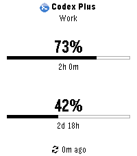
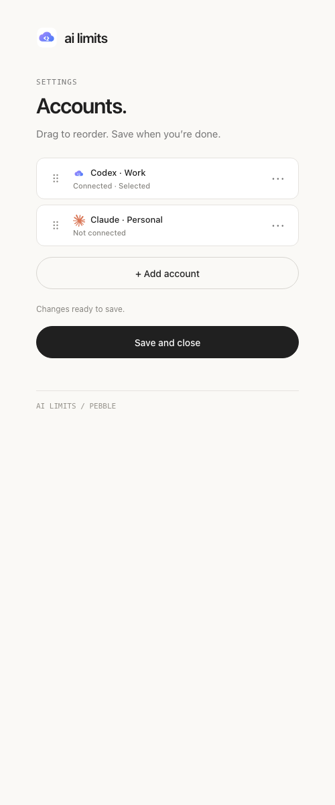

# AI Limits for Pebble

[](https://github.com/sspaceless/pebble-ai-limits/actions/workflows/ci.yml) [](https://github.com/sspaceless/pebble-ai-limits/releases/latest) [](LICENSE) 

A native Pebble app for **Codex, Claude, Gemini CLI, Claude API, Gemini API, and custom providers**. Check quotas and reset countdowns from your watch, with multiple named accounts for every provider. Fresh data requires a paired phone and internet access.

| On the watch | In phone settings |
| --- | --- |
|  |  |

These previews use demonstration data. See [all watch and phone screenshots](preview/README.md).

## Provider support

| Connection | Display | Setup |
| --- | --- | --- |
| Codex | Remaining percentages and reset times | [ChatGPT login](docs/providers.md#codex) |
| Claude subscription / Claude Code | Used percentages and reset times | [Claude Code credentials](docs/providers.md#claude-subscription) |
| Gemini CLI | Used percentages for two models and reset times | [Gemini CLI credentials](docs/providers.md#gemini-cli) |
| Claude API | Configured requests/min and input tokens/min caps | [Organization credentials](docs/providers.md#claude-api) |
| Gemini API | Configured requests/min and requests/day caps | [Google Cloud OAuth](docs/providers.md#gemini-api) |
| Custom | Remaining percentages and reset times | [HTTPS JSON endpoint](docs/providers.md#custom-providers) |

**API caps are configured limits, not remaining quota.** Gemini CLI reports Code Assist quotas, not Gemini website usage. Subscription integrations use internal endpoints whose availability can change. See [provider setup and access requirements](docs/providers.md) and [verification status](docs/verification.md) before connecting.

## Install and connect

1. Install the [Pebble mobile app](https://repebble.com/app) and pair your watch.
2. Download the latest `ai-limits-*.pbw` from [GitHub Releases](https://github.com/sspaceless/pebble-ai-limits/releases/latest). Transfer it to your iPhone using AirDrop or Files, open or share it with Pebble, and install it from the locker. Install over the existing version when upgrading.
3. Open **AI Limits** settings, expand **+ Add account**, choose a provider, and name the account.
4. Follow the [connection instructions](docs/providers.md), then tap **Save and close**.
5. On the watch, use **UP / DOWN** to switch accounts and **SELECT** to refresh. Data also refreshes every five minutes while the app is open.

In phone settings, drag account handles to reorder them, or focus a handle and use Arrow Up / Arrow Down. The **⋯** menu lets you rename, reconnect, or remove an account. **Save connection** stages credentials; **Save and close** saves all changes. **Cancel** closes the active form and keeps settings open.

The watch shows the provider, available plan, and account name (hidden when there is only one account). Cached values can appear while a refresh runs. After a reset passes, the watch shows `Awaiting update` until fresh data arrives.

Supports Classic / Steel, Time / Time Steel, Time Round, Pebble 2, Time 2, Pebble 2 Duo, and Round 2. The interface is in English.

Credentials stay in the phone companion's `localStorage`; this is not iOS Keychain. Removing an account deletes its local credentials but does not revoke the provider session. See [runtime and storage](docs/providers.md#runtime-and-storage) for details.

## Development

Set up Node.js, Python, and the Pebble SDK using the [development guide](docs/development.md), then run:

```sh
npm run check
.venv/bin/pebble build
npm run package:release
```

The guide covers dependencies, emulator installation, live provider checks, and releases. See [architecture and conventions](docs/architecture.md), the [verification matrix](docs/verification.md), and [provider asset sources](assets/BRANDS.md) for the related contracts and limitations.
